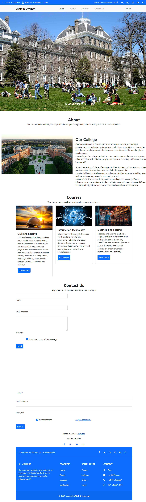

# Campus-Connect

## Project Preview

Here is a preview of my Campus Connect webiste.

🎓 Campus Connect – College Website

A responsive college website developed to showcase campus information, academic courses, and essential college-related details through a clean and user-friendly interface.

📌 Project Overview

Campus Connect is a front-end web development project designed to provide visitors with an overview of a college campus. It brings together important sections such as campus information, available courses, contact details, and a login interface in one place.

The website uses Bootstrap components to create a structured layout and improve responsiveness across different screen sizes.

✨ Features

Responsive Navigation Bar: Easy navigation between Home, About, Courses, and Contact sections.
Image Carousel: Displays campus-related images using Bootstrap Carousel.
About Section: Provides information about the college environment, personal growth, mentorship, and experiential learning.
Courses Section: Showcases three academic disciplines:
- Civil Engineering
- Information Technology
- Electrical Engineering
Contact Section: Includes input fields for name, email address, and message.
Login Interface: Provides an email and password login UI.
Social Media Integration UI: Displays social media icons for different platforms.
Footer Section: Contains contact information and useful navigation links.

🛠️ Technologies Used

HTML5
CSS3
Bootstrap 5

💡 Learning Outcomes

Through this project, I gained practical experience in:
Structuring web pages using semantic HTML.
Styling web pages using CSS.
Implementing responsive layouts with Bootstrap 5.
Working with Bootstrap components such as Navbar, Carousel, and Cards.
Integrating external fonts, icons, and images.
Organizing website content into multiple sections.
Designing forms and user interface components.

🔮 Future Enhancements

Implement functional user authentication.
Connect the contact form to a backend service.
Add student registration functionality.
Include campus announcements and event updates.
Add a dedicated student dashboard.
Improve accessibility and form validation.

👨‍💻 Author

Shireesha
GitHub: https://github.com/SireeC
